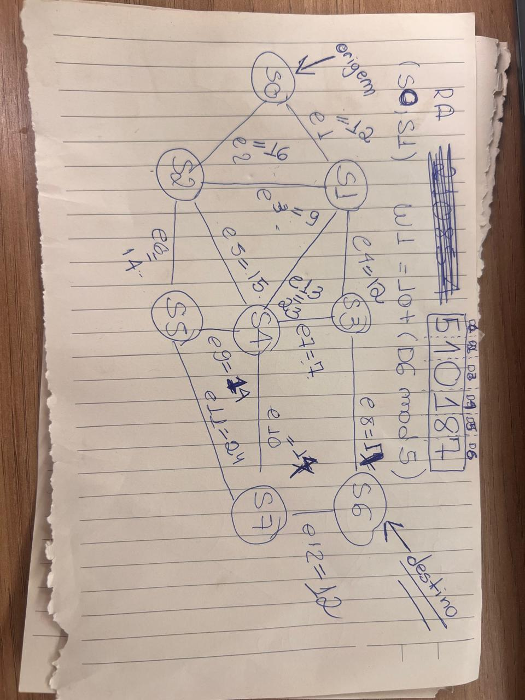
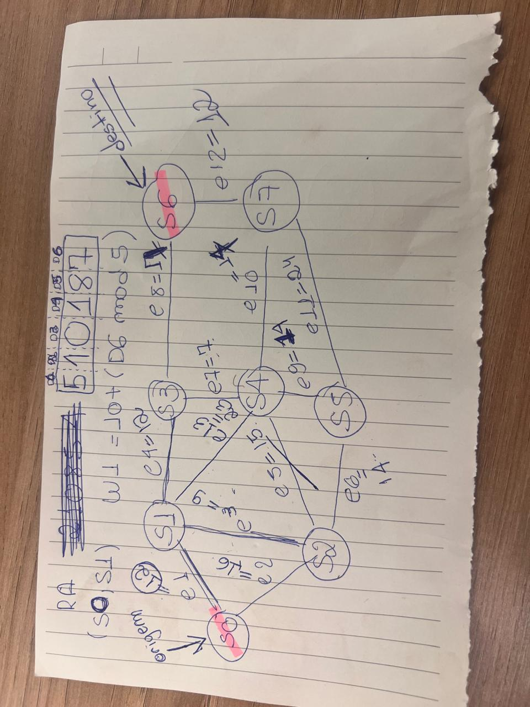
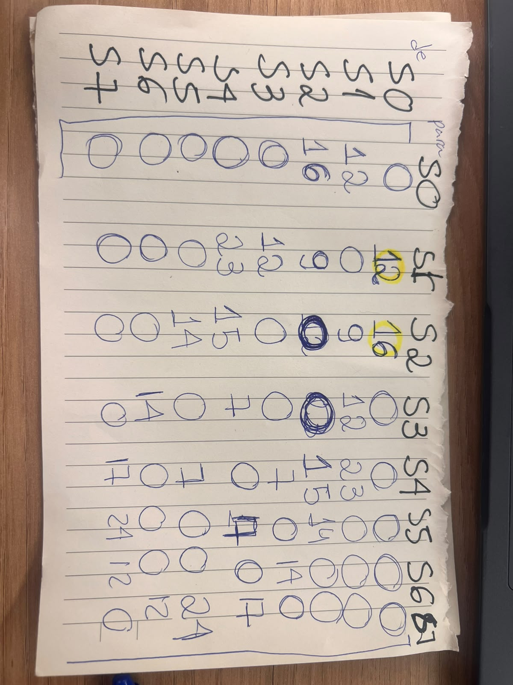
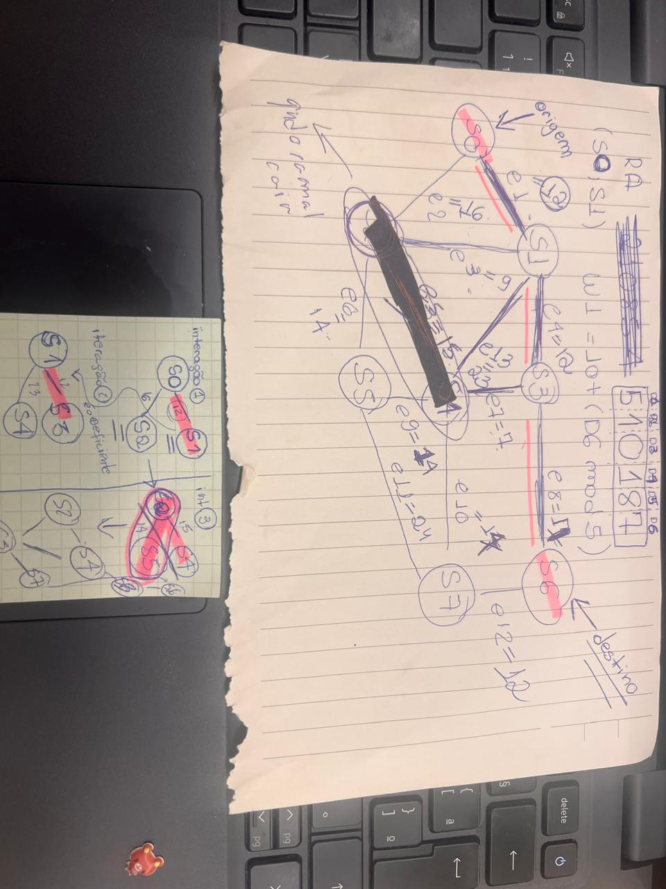
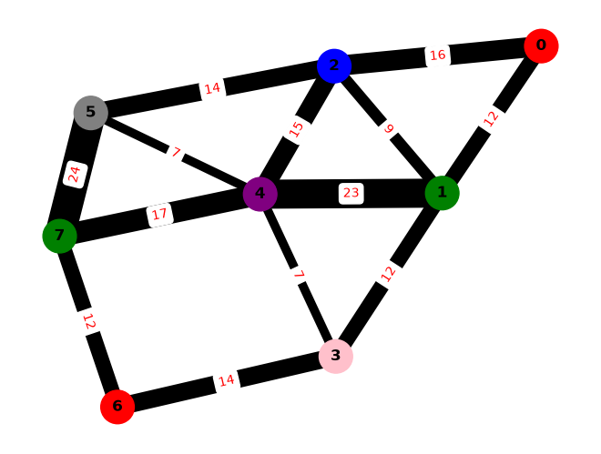

# Ponderada
- Antes de começar queria explicar que escolhi usar o Jupiter nootebook porque queria ver as partes da execução do código, poder plotar o grafo que eu tava fazendo e ver se fazia sentido com o que tava no meu papel

## Etapa 1: 
- Tem uma função só pra calcular, eu tenho o calcular.py que eu usei pro papel e tem o outro bloco 
- Peguei um exemplo de execução da sintaxe com a lib e basicamente fui alterando com a sintaxe e adequando pro que tava dentro do meu papel

- Eu não lembava mais cores em ingles, mas aproveitei isso pra deixar em vermelho o destino e a chegada: 
    S0 é a origem e como o último número do meu RA é impar, a saída é S6
- Usei uma função pronta da lib mesmo pra matriz, mas eu tlgd nas regras e fiz no papepl também 
    - Tem uma regra de usar NULO ou "-", eu arrumei de um jeito porco mesmo, basicamente eu percorri o array e onde tinha zero troquei por "NULO"

- Vi agora que errei a formula do e8, já arrumei

- Essa parte de baixo foi o que eu fiz no papel, tava meio concentrada e to documentando agora, o grafo não é direcionado tanto que já meio que me adiantando, no Prim vamo ir e voltar, (to falando isso, me adiantando tlgd que estamos fazendo o Djskitstra)  daí bem basicamente eu foquei em escrever e entender a logica do código e como ele ia rodar tentando me basear no modelo que já existia, S0 é o começo/origem e S6 é o destino porque o final do meu RA é 7 como eu coloquei ali em cima, usei o calcular.py pra pegar os valores, queria um valor, mas não garanto que é esse valor mesmo porque fiz na mao. Isso é um esboço visual de entendimento, a versão que eu fez no nootebook tá mais real.

- Aqui é a mesma cois, mas queria um esbocinho mais completo e recente 

### Tabela dos pesos 
 - direto dos meus prints porcos, repeti o que tava no calcular.py e meio que refiz no nootebook 

| Ramal | (Si, Sj) | Fórmula | Peso (km) |
|---|---|---|---|
| e1 | (S0, S1) | 10 + (7 mod 5) | 12 |
| e2 | (S0, S2) | 15 + (8 mod 7) | 16|
| e3 | (S1, S2) | 8 + (1 mod 4) | 9|
| e4 | (S1, S3) | 12 + (0 mod 6) | 12|
| e5 | (S2, S4) | 14 + (1 mod 5) | 15|
| e6 | (S2, S5) | 9 + (5 mod 6) | 14|
| e7 | (S3, S4) | 7 + ((8 + 7) mod 5) | 7  |
| e8 | (S3, S6) | 11 + ((1 + 8) mod 6) | 14|
| e9 | (S4, S5) | 6 + ((0 + 1) mod 4) | 7|
| e10 | (S4, S7) | 16 + ((1 + 0) mod 7) |17 |
| e11 | (S5, S7) | 18 + ((5 + 1) mod 8) | 24|
| e12 | (S6, S7) | 9 + ((8 + 5) mod 5) | 12|
| e13 | (S1, S4) | 20 + (7 mod 4) | 23|
 
### Minha matriz de adjencia no papel 

Tentei seguir o exemplo 

## Etapa 2 

- vou mandar meus postits, mas eu meio que fiz muito nesa tabela, já que eu já ia tranferir mesmo pq queria ver a lógica em algum lugar, mas ia me perder muito fácil, eu tentei fazer por interação também, mas eu não tenho paciencia e o postit é pequeno, inclusive esse risco preto é se o ramal cair então tentei deixar claro pro meu cerebro que ele caiu, mas eu não to contando na tabela não, só to botando ai porque vou usar depois. O S= 38 tava dando isso, então quando eu via uma que já tava dando 28 em dois por exemplo nem compensava.

- O que eu fiz foi basicamente pensar em tudo como se fosse uma variavel prime assim que tem a soma, primeiro eu olho o lado com mais eficiencia e fui meio que somando e que depois eu considero que se já tá maior, não funciona

| Iter. | u | L[u] | L[S0] | L[S1] | L[S2] | L[S3] | L[S4] | L[S5] | L[S6] | L[S7] | Antecessores atualizados |
|---|---|---|---|---|---|---|---|---|---|---|---|
| Inic. | — | — | 0 | ∞ | ∞ | ∞ | ∞ | ∞ | ∞ | ∞ | Inicialização na origem S0 |
| 1 | S0 | 0 | [0] | 12 | 16 | ∞ | ∞ | ∞ | ∞ | ∞ | Ant[S1] = S0 (0 + 12 = 12), Ant[S2] = S0 (0 + 16 = 16) |
| 2 | S1 | 12 | [0] | [12] | 16 | 24 | 35 | ∞ | ∞ | ∞ | Ant[S3] = S1 (12 + 12 = 24), Ant[S4] = S1 (12 + 23 = 35) |
| 3 | S2 | 16 | [0] | [12] | [16] | 24 | 31 | 30 | ∞ | ∞ | Ant[S4] = S2 (16 + 15 = 31), Ant[S5] = S2 (16 + 14 = 30) |
| 4 | S3 | 24 | [0] | [12] | [16] | [24] | 31 | 30 | 38 | ∞ | Ant[S6] = S3 (24 + 14 = 38) |
| 5 | S5 | 30 | [0] | [12] | [16] | [24] | 31 | [30] | 38 | 54 | Ant[S7] = S5 (30 + 24 = 54) |
| 6 | S4 | 31 | [0] | [12] | [16] | [24] | [31] | [30] | 38 | 48 | Ant[S7] = S4 (31 + 17 = 48) |
| 7 | S6 | 38 | [0] | [12] | [16] | [24] | [31] | [30] | [38] | 48 | — (destino fechado) |

Rota ótima: S0 -> S1 -> S3 -> S6  
Custo: 38 km
Ordem de fechamento: S0, S1, S2, S3, S5, S4, S6

- O S7 tá ognorado porque nosso destino é S6, não teve empate, mas se tivesse é bom deixar registrado que eu iria no que tivesse o menor indice 
- E daí na volta inverteno as ordens ainda compensa o mesmo caminho só que com origem e destinos inversos: S0 <-> S1 <- S3 <- S6 

## Fase 3 
Ihhh fui ler agora e meio que já fiz parte da fase 3
- Usei basicamente a base de código de um arquivo de treino que eu tinha feito treinando com o Claude e meio que fui mudando umas coisas 
- Peguei uma função pronta pra validar também e de verdade to fazendo esses codigos ai pq falaram que vale nota, mas o bom é que no geral era mudar função e nome das que eu já tinha meio que feito com o Claude então meio que deu e tals, pras funções eu usei o Gemini do Google pra me dar o modelo de como fazia

## Fase 4
### Questão 1 — Rota e custo ótimo. Qual é a distância total mínima (em km) e a sequência exata de subestações de S0 até o seu destino? Liste a ordem cronológica em que os vértices foram definitivamente fechados pelo Dijkstra.
- S0->S1->S3->S6: Somando os caminhos dá 38
- Quem ele visita? S0, S1, S2, S3, S4, S5, S6 (Ou seja, uma BFS)

### Questão 2 — Contingência no ramal (S2, S4). Simule a queda de uma torre no ramal e5 =(S2, S4), removendo a aresta (w5 = ∞). Determine a nova rota ótima e calcule o acréscimo de custo em km e em percentual.
- Nos dois testes que eu fiz não deu nenhuma diferença, ou seja, 0 km.
### Questão 3 — Prim (MST) × Dijkstra. Calcule o custo total da Árvore Geradora Mínima (Prim) que mantém as 8 subestações conectadas. Compare-o com a soma das distâncias de Dijkstra e explique por que a união das rotas radiais não gera a MST.
- Na saida dos vertices:
(S0, S1) = 12 km
(S1, S2) = 9 km
(S1, S3) = 12 km
(S3, S4) = 7 km
(S4, S5) = 7 km
(S3, S6) = 14 km
(S6, S7) = 12 km
73

- Porque Prim busca unir todos os vertices, esse é o objetivo core dele e por isso ele vai ser mais eficiente, ele produz 73 km como mos e o Djskitra quer achar o caminho mais eficiente baseado em sua origem e sua chegada, ele busca encontrar essas possibilidades e caminhar sobre elas sem objetivar a menor chegada, mas sim o caminho minimo, por isso, custa mais somando tudo dá 199 km. 
